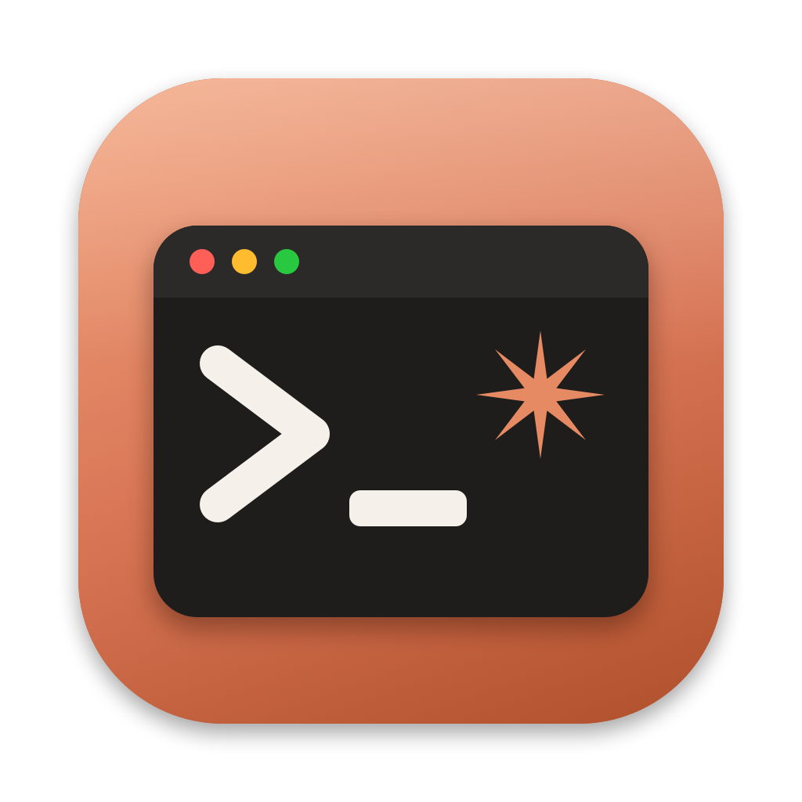

# Claudeman

A native macOS app for managing projects built with [Claude Code](https://claude.com/claude-code).
Each project points at a folder, and Claude Code runs inside the app in a real terminal,
exactly as it does in Terminal.app, with every session kept together in one window.



## Features

- **Projects sidebar**: add a project from a folder (⌘N, or drag a folder onto the sidebar), or clone one straight from GitHub (⇧⌘N).
- **Clone from GitHub**: browse your repositories through the GitHub CLI, or paste any `owner/repo` or URL. The clone becomes a new project and can start a Claude session right away.
- **Session tabs**: run several Claude Code sessions per project. They keep running while you switch tabs or projects.
- **Restart ended sessions**: when Claude exits, start a new session, continue the last one (`claude --continue`), or pick an older one (`claude --resume`).
- **Remote control from iPhone and iPad**: the Claudeman Remote companion app lists your projects and lets you start, continue, restart or stop sessions from anywhere on your network, or over Tailscale when you're away.
- **Customisable**: light/dark/system appearance, eight terminal themes, font and size, cursor style, Option-as-Meta, confirmations, default launch mode and clone folder.

### Shortcuts

| Shortcut | Action |
| --- | --- |
| ⌘N | New project from folder |
| ⇧⌘N | Clone from GitHub |
| ⌘T | New session |
| ⇧⌘T | Continue last session |
| ⇧⌘R | Resume a past session |
| ⇧⌘W | Close session tab |
| ⌘, | Settings |

## Requirements

- macOS 14 or later
- Xcode command line tools (Swift 5.10+)
- [Claude Code](https://docs.claude.com/en/docs/claude-code) installed (`claude` on your PATH)
- Optional: [GitHub CLI](https://cli.github.com) logged in with `gh auth login`, to browse and clone private repositories

## Build

```sh
./scripts/bundle.sh        # builds build/Claudeman.app
open build/Claudeman.app
```

During development you can also run it directly with `swift run`.

To regenerate the app icon after editing `scripts/make-icon.swift`:

```sh
swift scripts/make-icon.swift
```

## Claudeman Remote (iPhone and iPad)

The companion app lives in `iOS/`. It's a SwiftUI app for iOS 17 and later.

### Set up

1. On the Mac, open **Claudeman › Settings › Remote** and turn on **Allow remote control**.
2. Open `iOS/ClaudemanRemote.xcodeproj` in Xcode, choose your iPhone or iPad, and press Run.
3. In the app, tap **Pair a Mac**. Your Mac appears under *On This Network*. Tap it.
4. On the Mac, click **Pair Device…** and type the 6-digit code into the phone.

To control the Mac when you're away from home, install [Tailscale](https://tailscale.com) on both devices. Then add the Mac by its Tailscale address, which Settings › Remote shows.

### What it can do

- See every project and its sessions: running or ended, plus the task title Claude sets.
- Start a new session, or continue the last conversation, in any project.
- Restart a session (new or continue), stop a running one, or close an ended tab.

It can't show a session's screen or type into it. Use the Mac for that.

### Security

- Remote control is off until you turn it on.
- A device must pair with a short-lived 6-digit code. Five wrong guesses cancel the code.
- Each paired device gets its own random token. The Mac stores only a SHA-256 hash of it, and you can remove a device at any time in Settings › Remote.
- Traffic is plain HTTP. On your own Wi-Fi that's a reasonable trade-off. Over Tailscale it's encrypted end to end. Don't forward the port to the internet.

If you change the shared API types in `Packages/ClaudemanKit`, rebuild both apps. To regenerate the Xcode project after editing `iOS/project.yml`, run `xcodegen generate` in `iOS/`.

## How it works

- Sessions run in a pseudo-terminal provided by [SwiftTerm](https://github.com/migueldeicaza/SwiftTerm).
- Commands start through your login shell (`$SHELL -l -c`), so `claude`, `git` and `gh` are found even when the app is opened from Finder. If `claude` lives somewhere only your `.zshrc` adds to PATH, set its full path in Settings.
- Projects are stored in `~/Library/Application Support/Claudeman/projects.json`.
